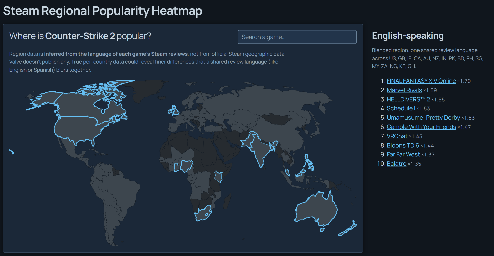

# Steam Regional Popularity Heatmap

An interactive world map showing which Steam games are **disproportionately
popular in each region**, not just globally popular. The map shows one game's
concentration heatmap at a time. The default game is the top-1. You can also search 
*any* Steam game beside the top-100 most popular game that are tracked every day.
Hover a region for an instant top-3 preview, or click to pin its full top-10, 
ranked by how much more concentrated that game's audience is there than
the worldwide average.

**Live at [steamheatmap.azurewebsites.net](https://steamheatmap.azurewebsites.net)**
(free-tier hosting, has a coldstart problem and takes a few extra seconds to load after idle).



## The problem

Steam per-country or per-region player data is not public. Anyone curious 
whether a game is a phenomenon in Japan or Brazil specifically, rather than 
just big everywhere, has no tool to find out.

## The approach

Every Steam review carries a language. A game's **review-language
distribution** is public, fetchable per game, and a usable proxy for where its
players are, with some honest disclaimers: 
-This language evaluation approach is a proxy to infer a game's popularity in 
one region, it is not an acurate measure but an approximation.
-Some languages blend many countries; English reviews for example say little
about a single anglophone country.

The interesting part is making the ranking trustworthy:

- **Concentration, not volume**: a game ranks high in a region when its share
  of reviews in that region's language is far above the region's *baseline*
  across all tracked games. This surfaces regional favorites instead of
  repeating the same global blockbusters on every continent.
- **Wilson score lower bound**: when we talk about percentages, small samples
  are noisy, so the ranking uses the Wilson interval's lower bound. This
  statistical method asserts that a game with 8 of 12 reviews in Japanese
  scores far below one with 2,000 of 3,000.
- **Ranking eligibility**: Wilson can't catch a tiny share divided by an even
  tinier baseline (9 Arabic reviews out of 111,974 once scored very high).
  A game therefore needs at least 50 reviews in a region's language to be
  ranked there; a region with no eligible games renders as "no data" rather
  than as noise
  ([ADR-013](adr/013-ranking-eligibility-minimum-sample.md)).

The result on real data: Street Fighter 6 tops Japan at ×11 concentration
while barely charting in South America, which is exactly the regional signal 
we want to measure.

## Architecture

```
Steam Web API ──▶ Python daily pipeline ──▶ Postgres (Supabase) ──▶ ASP.NET Core MVC + D3 map
                  (GitHub Actions, cron)                            (reads latest run only)
```

- **`analysis/`** — Python. Once a day (GitHub Actions): fetch the current
  top-100 most-played games, pull per-language review counts for all 30 Steam
  review languages (~4,250 keyless API calls, 4% of the rate cap), compute
  Wilson-adjusted concentration scores per region, write to Postgres. A
  separate weekly job caches every Steam app's id and name (the one keyed
  Steam call in the project) so full-catalog search has something to query.
- **`web/`** — C# ASP.NET Core MVC. Reads the latest computed run from
  Postgres for the map itself, and never calls Python directly. It does now
  hold one narrow, request-scoped Steam-calling path of its own: searching a
  game outside the daily-tracked set fires a live, parallelized fetch and
  score against the same Wilson/concentration math the Python pipeline uses,
  writes through the same schema, and repaints instantly — no page reload
  ([ADR-006](adr/006-csharp-python-shared-database-integration.md)'s
  amendment). Server-rendered Razor + plain CSS; D3.js scoped to the map
  widget, drawing self-hosted Natural Earth country boundaries.
- The two codebases share the database, the top-level docs, and — for this
  one on-demand path — logic that's independently ported and tested on each
  side rather than shared as a library
  ([ADR-006](adr/006-csharp-python-shared-database-integration.md)).
- Hosting: Azure App Service (F1 free tier) for the web app, deployed by
  GitHub Actions on every push to `main` touching `web/`; Supabase free tier
  for Postgres ([ADR-007](adr/007-hosting-free-tier-then-vps.md)).

## Running locally

Both apps need `SUPABASE_DB_URL` in the environment (a Postgres connection
URI).

```bash
# Pipeline (from analysis/):  full run, or a cheap smoke run
python run_daily.py
TOP_N_GAMES=3 python run_daily.py

# Web app (from web/)
dotnet run

# Tests
python -m pytest                                   # from analysis/
dotnet test tests/SteamHeatmap.Web.Tests.csproj    # from web/
```

## How it's built

The engineering process is part of the product: strict TDD with one behavior
per test, one commit per red→green→refactor cycle, decisions interviewed and
recorded as ADRs, and end-to-end verification (live API runs, scripted
headless-browser checks) before any issue closes. The git history is meant to
be read — see **[docs/methodology.md](docs/methodology.md)** for the process
and its chronological evolution, and **[adr/](adr/)** for the sixteen
architecture decision records behind the design.

## Disclosures

Region data is inferred from review-language distribution, not official Steam
geographic data. This project is not affiliated with or endorsed by Valve.
Data powered by [Steam](https://store.steampowered.com/).
